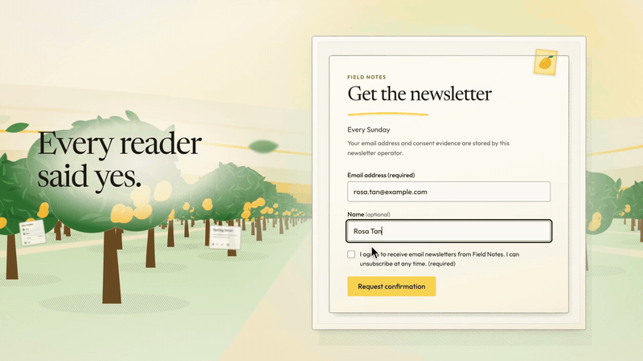
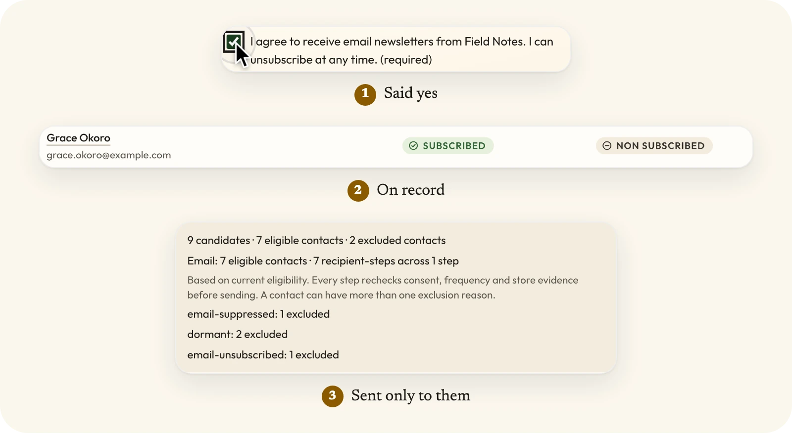
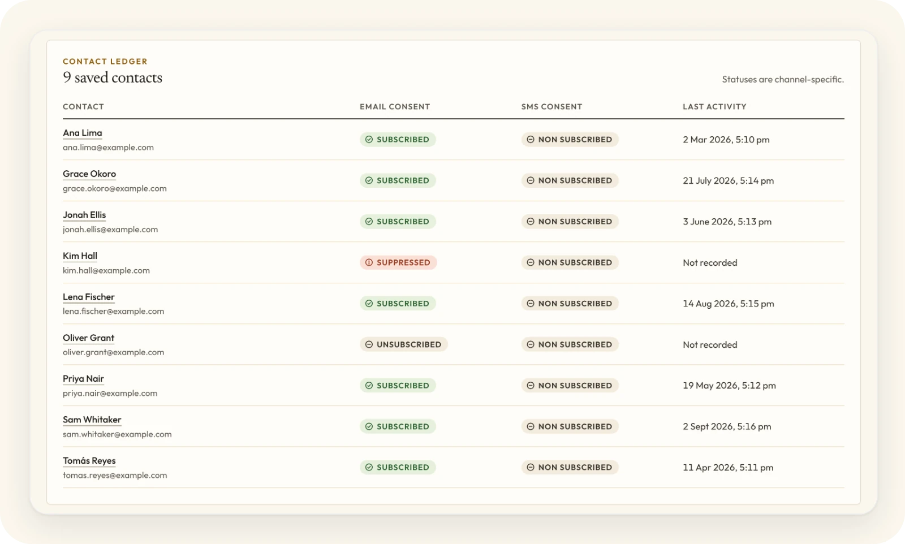
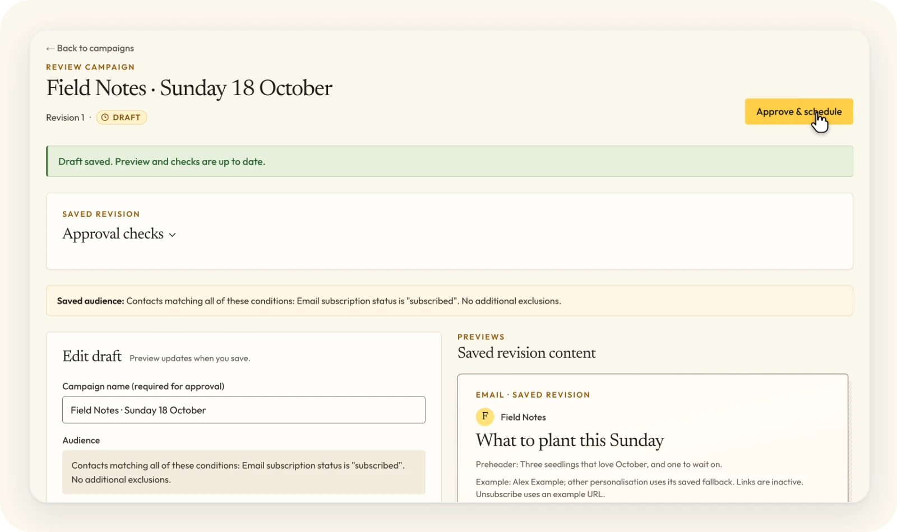

<p align="center">
  <a href="https://run-mango.com">
    <picture>
      <source media="(prefers-color-scheme: dark)" srcset=".github/assets/banner-dark.webp">
      <source media="(prefers-color-scheme: light)" srcset=".github/assets/banner-light.webp">
      
    </picture>
  </a>
</p>

<p align="center"><a href="https://run-mango.com">run-mango.com</a> · <a href="https://justevery.com">Part of Just Every</a> · <a href="LICENSE">MIT licensed</a></p>

<p align="center">
  <a href="https://justevery.com/#vol-mango"></a>
</p>
<p align="center"><a href="https://justevery.com/#vol-mango"><b>Watch the full demo</b></a> · 45 seconds</p>

<p align="center">
  
</p>

<p align="center">
  <br>
  <sub>Consent is recorded per contact and per channel.</sub>
</p>

<p align="center">
  <br>
  <sub>Review the exact revision before it is scheduled.</sub>
</p>

# Mango

Mango is an approval-first newsletter desk. Public source: [just-every/run-mango](https://github.com/just-every/run-mango), version 0.1.0. CONTRACT.md preserves the complete product target; ACCEPTANCE.md separates the current local milestone from release obligations. The default newsletter profile supports operator-authored email with optional commerce, SMS and AI. Wider contract obligations and unverified release gates remain documented in ACCEPTANCE.md.

## Run it on your computer

```sh
git clone https://github.com/just-every/run-mango.git
cd run-mango
```

Install `rer` once per computer with `npm install -g @runeditrun/rer` (or `curl -fsSL https://runeditrun.com/install.sh | sh`). In this checkout it selects pinned rer **0.2.2**, which acquires and uses Node **22.20.0** and pnpm **10.12.4** and installs the locked dependencies. You do not need to install Node or pnpm separately when using the installer script. Run from the project root and supply your own owner email.

```sh
rer install
rer setup --owner-email owner@example.test
rer dev
```

Wait for `RER_READY`. `rer dev` opens signed in: it prints `RER_SIGNED_IN` (the owner) and `RER_OPEN`, a link that carries this checkout's private dev key in its fragment. Open `RER_OPEN` in a browser on this computer and you land signed in as the owner; a small dev badge switches to the `teammate` persona (a second operator beside the owner; Mango operators hold equal authority) or signs out. Never share the link: the key is what keeps the outbox and dev sign-in closed to anything that reaches this port through a proxy or tunnel, and `reset` removes the key so every earlier browser session stops working. `--as teammate` (or `--as signed-out`) starts as another persona, and `--login` turns dev identity off so dev prints `RER_SIGN_IN` and a key-carrying `RER_OPEN` for the outbox instead: choose the newest message, follow its link and press Confirm (no email is sent). `RER_OPEN` is for people at this terminal; scripts use `rer dev --json` or the key header. The sign-in opens `/setup`, where you save your business sender identity before entering `/app`. A configured installation goes straight to the app; sender details remain editable in Settings. Setup exits with no server running; stop dev with Ctrl-C before verification or data operations.

```sh
rer verify
rer reset --yes
rer export --output exports/mango.jsonl
rer import --input exports/mango.jsonl --yes
rer deploy --environment production --dry-run
rer describe
```

Reset deletes local data and credentials. Export before resetting if you need that data; import requires an empty destination and the matching private settings backup. The commands above are separate operations, not a reset-and-backup sequence. Real deployment requires authorized owner-account credentials. Follow the complete [deployment recipe](OPERATIONS.md#deployment): `rer deploy --environment production`. Pinned rer 0.2.2 deploys the Worker, automatically claims the first owner through native bootstrap and removes the one-time setup token from the Worker. Repeat deployment preserves the existing owner. For updates, preserve private inputs and the deploy receipt, run `git pull --ff-only`, then `rer deploy --environment production` with the same environment and loaded private inputs. rer handles the pinned tools and dependency install. The recipe also supplies optional receiver and QA inputs. See [OPERATIONS.md](OPERATIONS.md) for recovery and configuration; `describe --json` lists the actual flags, and `check --profile first-party` checks the command contract.

Setup builds and migrates local D1, creates one real first owner, and preserves existing owner/data/private bytes on repeat runs. `--port PORT` and `--host HOST` select a loopback origin; dev overrides do not rewrite saved settings. For browser verification install Chromium with `pnpm exec playwright install chromium`. Production configuration may remain absent during local work. [RUN-LOCALLY.md](RUN-LOCALLY.md) provides the short command guide.

Sample data is opt-in in the separate test-only workspace: `pnpm run review:synthetic`. It serves its own `/__dev/outbox` and takes its origin from `MANGO_REVIEW_BASE_URL` in the ignored `wrangler.review.toml`, so local development settings cannot redirect it to the dev port. Open the link written to `.seed/review-access` once so the review operator exists; you can then request a sign-in link for `review@example.test` at `/signin`, open the development outbox and press Confirm, as in `rer dev --login`.

## Source synchronization

`POST /api/store/sync` requires a native operator session and production Origin preflight, validates a declared source/provider, and returns `202 queued` with a durable run ID. The Store page shows saved pages/records and offers resume or explicit restart. Workers save a cursor after each fully ingested page and continue in chunks of ten; a pending chunk is acknowledged only after the queue accepts a new continuation carrying the same run ID. This transfers the remaining work without consuming the failure retry allowance or claiming completion. Failed continuation acceptance and busy work retry. Terminal completion and supersession acknowledge directly. A repeated cursor fails visibly. Full freshness is recorded atomically with the final checkpoint.

An interrupted run resumes its saved page rather than starting over; partial-page replay uses identity upserts. Leases guard actual source/activity/contact writes as well as checkpoints, so a worker that loses ownership cannot overwrite its replacement. An explicit replacement supersedes the old failed run without deleting its history. Public status excludes internal cursors and lease credentials. Apply migrations in filename order; preserve existing source records and checkpoints. Real queue retry limits, expired provider cursors, deletion semantics and hosted operation still need provider-specific release proof.

With the synthetic review running, `node scripts/prove-sync-recovery.mjs` drives a local second-page failure, approval blocking, saved-page resume and reload recovery on desktop/mobile. The test Worker executes source jobs against its two-page synthetic adapter while holding every marketing dispatch. Its fault controls require the local bootstrap capability. No external request or delivery is involved.

`POST /api/campaigns/:id/checks` reviews a saved draft through the same evaluator as approval, stores checks and returns current source status, counts and exclusions. It creates no recipient-step, approval or send. Approval re-evaluates the exact revision rather than trusting this preview.

## Synthetic workflow recovery

With the review server running, `node scripts/prove-synthetic-workflow.mjs` creates a uniquely named synthetic campaign and verifies actual browser save/reload, approve/reload and cancel/reload against local D1. Earlier scenarios and edits are retained. The protected open route accepts an optional validated `scenario=synthetic-review-<identity>` for a separate fixture; opening an existing identity preserves its revision and approval history. The email panel renders a sanitized saved-revision example with desktop/mobile widths, a labelled example recipient and inactive unsubscribe/link targets.

## Email authoring and preview

The bounded authoring set permits paragraphs, div/span, headings, basic emphasis, lists, blockquotes, tables, links and images. Attributes are limited to title, link href, image src/alt/explicit width and height, and table-cell row/column spans. Attributes must be quoted; links and image sources must be HTTPS. Scripts, forms, embedded/namespace content, stylesheets, classes, event handlers and unquoted or malformed attributes block approval. Personalisation is allowed in text with an explicit nonempty fallback; the managed unsubscribe URL is the only token accepted in an HTML attribute.

Designed emails may also carry validated inline styles and a few presentational table attributes (MSG-009, MSG-012): hex colours, named font stacks, sizes, spacing, borders and radii, written as plain `property: value` declarations with no CSS function, comment, escape, entity, at-rule or `!important`. The grammar is built so that text cannot leave the table cell that holds it: only table cells (`td`, `th`) may set a background (`background-color` or `bgcolor`), besides the email's outer wrapper (the first `div` at the top level of the body that sets one; Mango's design compiler puts the page colour on the one cell of a full-width table instead), no element may declare `display`, widths and heights stay on tables, cells and images (a cell or table grows to hold what it contains; an empty box may also take a height), inline elements take no borders, a painted cell rounds its corners only within its padding, right-to-left text sits in a cell, and styled cells may not overlap. Every text run must then reach 3:1 contrast against the background of its nearest painted cell, or outside any against the wrapper's colour and the page's white (a block such as the wrapper does not hold a line too long for the screen), in quirks and standards rendering; styles that hide, clip, fade, shrink, move, overlay or reverse text are rejected, and styled markup must be written the way browsers build it. One parser reads every body: `email-html-parse.ts` runs parse5, the WHATWG HTML parsing algorithm, in the Worker and the browser, so the checker (`email-html-policy.ts`, `email-presentation.ts`, `email-placement.ts`, `email-style-declarations.ts`, `email-contrast.ts`), the preview and the plain-text part all judge the tree a recipient's mail client builds, and markup that clients read differently from how it looks (a malformed tag such as `</ span>`, an unquoted attribute, a comment) is refused as written. That one checker decides approval, test send and delivery, and the preview keeps a body's styles only when it passes. Saving stores the body as the parser reads it (its canonical form: elements closed where they end, attributes double-quoted, characters instead of character references), so every saved revision reads the same in every client, and delivery sends exactly those saved bytes. Saving never changes a style or an attribute value and never refuses a body for how it is written: what parsers drop (the second of an attribute written twice, a table cell outside a table with its attributes) is dropped from the saved copy too, so the checker judges exactly what recipients see. Where each presentational property may stand is decided in `email-placement.ts` (overlapping cells in `email-table-slots.ts`), each rule with the reason the grammar needs it; text that runs past the right edge of the email lands on the page, as long words always have. Nothing is repaired: a rejected body is named and stays a draft. The full list and its security consequences are the MSG-009 and MSG-012 policy in CONTRACT.md. Rich text editing keeps only unstyled markup, so a styled body opens in HTML mode.

**Import 12ui design** (DESIGN-004) turns a design made with the owner's own `12ui` CLI (`12ui draft …`, then `12ui convert <candidate.png> --engine api --output layerdoc --model fast`) into the email body. The LayerDoc version 2 file and its PNG candidate stay in the browser: `src/core/features/design-import` crops the photos and uploads them as campaign images (CAMP-012), then compiles a 600px table email in this same grammar, with the operator's HTTPS button link and Mango's managed footer. The result is an unsaved edit, checked by the approval checker before it reaches the editor; lines the design wrote that are not in the operator's brief are highlighted. Import itself uses no 12ui key and makes no request to 12ui. In HTML mode, **Insert image** uploads one picture as a campaign image and writes its `` at the cursor. On a copy running on a computer (`http:` origin), the editor, save and preview accept the deployment's own `/media/` images, and approval names the HTTPS requirement. Steps are in docs/first-newsletter.md.

**Design with 12ui** (DESIGN-001 to DESIGN-003) appears beside it only when the optional design module is configured with the owner's own 12ui key (`DESIGN_PROVIDER_API_KEY`, `DESIGN_PROVIDER_ORIGIN`). The operator edits a brief prefilled from the draft, sees the estimate, and a queued run (`src/core/features/design-generation`) buys two to four candidates through `design.provider.v1` (`src/core/platform/adapters/twelve-ui.ts`), stores them in R2 and shows them as they land. **Use this design** beside a candidate prepares its LayerDoc, which then goes through the same browser import path by itself; the run stays on offer until the draft is saved with the design. Runs never save, approve, schedule or send, record cost facts per paid request, say when 12ui makes them wait, and fail visibly with Mango's own reason.

The preview parses the saved revision with the same parser as approval and reconstructs only allowed HTML inside a sandboxed frame; it renders the validated set, and a body that fails approval is shown without its styles and with its warning, so presentation never hides text in the preview. Links cannot navigate. Known tiny or underspecified images are removed; other images stay blocked until requested. Declared dimensions cannot prove a publisher's tracking intent. The browser proof intercepts requested images locally and makes no provider/network hand-off. Saving refreshes checks and the stored audience under the saved draft's version guard. Preheader and postal address are editable; a sender identity different from configuration remains blocking.

With the review running, `node scripts/prove-email-preview.mjs` checks adversarial HTML (including every hidden, deceptive or remote-loading presentation case in `rejectedPresentation` in `tests/support/adversarial-email.mjs`, each saved in canonical form, previewed unstyled with its warning and blocked at approval), unsaved/saved boundaries, mobile editing/reload, inactive links, image permission, configured sender enforcement and immutable approval. The pure renderer is shared with delivery; preview supplies example values/capabilities. New approval digests include its version. Existing persisted outbound requests remain unchanged on retry; a future renderer upgrade still needs an explicit policy for approved revisions without a prepared outbound request. Full offer-equivalence and real inbox rendering/provider verification remain release obligations.

Approval also requires a visibly labelled managed unsubscribe anchor and exact agreement between the actual HTML href set, plain-text URLs and saved destinations. A URL hidden in a title or present only as HTML text does not satisfy those checks. The editor can add and remove saved destinations. Anchor contents are restricted to text and basic inline formatting; empty, nested, unclosed and non-inline link labels are rejected. This verifies destinations, not semantic equivalence of arbitrary offer wording.

## Provider safety facts

Verified email hard-bounce, complaint and suppression events apply to one canonical destination even when a campaign hand-off is unknown. They persist no invented delivery outcome. Conflicting provider event identities reject, mismatched recipient references cannot inherit the fact, and atomic suppression updates make retries safe. A suppression predating contact creation remains authoritative for eligibility; its evidence is included in the contact detail. Erasure removes unmatched inbox data for known destinations, including older formatted SMS numbers.

The additional test-only review link in `.seed/suppression-review-access` opens a synthetic suppressed contact through the normal local session entry. It clearly labels synthetic evidence and performs no provider call. Signed adapter ingress and failure recovery are separately proved by `tests/provider-suppression-ingress.spec.ts`. Browser review exercises the local application. Soft-bounce policy ingress and real provider verification remain incomplete.

## Local frozen-source package

From a clean committed author checkout, `node scripts/package-local-source.mjs ./source-package` writes a Git source archive, extraction and SHA-256 custody receipt. It refuses an existing destination and verifies every extracted tracked file against its Git blob and executable mode. `node scripts/package-local-source.mjs --verify ./source-package` checks the archive and tracked source against that receipt after startup or recovery. Preserve the receipt with its source commit as the trust anchor; this is an integrity check, not a signed publisher attestation. Generated state and dependencies are outside the source manifest. No release, installation or provider readiness follows from packaging.

The package retains author instructions and LICENSE exactly. It does not invent an edition manifest, rewrite consumer instructions, include ignored secrets/data, or install dependencies. A local acceptance run may link an existing `node_modules` cache after verifying the exact package/lockfile bytes; record that reuse instead of claiming a fresh install. `MANGO_REVIEW_PORT=15664 pnpm review:synthetic` can run a package's isolated synthetic review without disturbing the other preview on 15662. D1 and the local bootstrap capability stay inside that extraction's ignored `.seed` directory.

Saved audience review includes per-channel counts of eligible contacts using fallback text. It counts contacts once per channel, regardless of repeated tokens or steps. Counts reflect the saved review time and freeze at approval. Historical snapshots display unknown usage until a draft is reviewed again; approved history is preserved. Any draft save invalidates previous checks and audience counts.

## Base integration

The current integration uses Base operator-auth for every production session and
Base mail for transactional sign-in and SendGrid submission/signature verification.
See [OPERATIONS.md](OPERATIONS.md) for explicit bootstrap, provider configuration,
resource prefix and deployment commands, and the authenticated create-draft API.
Contact-based newsletter rules use recorded contact fields without requiring
commerce. Marketing remains fail-closed on missing transport/sender guarantees.
Migration 0015 preserves operator IDs and history but requires a fresh sign-in.
Native authentication fixtures and the SQL trigger loader preserve their security assertions. Hosted/provider acceptance requires separate exact-revision evidence.

## Writing a newsletter

Open **Campaigns → New campaign → Blank newsletter** to write without AI or commerce. Connected, current store records also appear as named starters with their source identity and occurrence time. Decision Desk **Use this** opens the same Review; selecting never sends or approves. **Generate suggestion** explicitly invokes configured AI with recorded deployment evidence and reports unavailable or failed generation without substitute content.

Authenticated API clients create a blank draft with `POST /api/campaigns` and `{ "mode": "blank" }` (or `{}`). Use `{ "starterSourceId": "<record-id>" }` for an available recorded signal. The existing `{ "composition": ... }` branch still requires a complete composition; partial edits belong to `PATCH /api/campaign-revisions/:revisionId`. Creation returns the campaign and revision IDs and creates no approval or delivery job.

Save incomplete work at any time. Enter a subject, preheader, message and consent category matching your contacts. The default editor supports rich text; **HTML mode** preserves allowed email markup. Emails with images remain in HTML mode until the images are removed, so editing does not load remote images. Saves add the unsubscribe and configured postal footer once, derive plain text with real links, and refresh the saved preview. Destination-link controls edit actual message links.

Audience inclusion/exclusion controls change the structured rules. Counts use current recorded contacts and consent; unavailable or stale commerce shows a blocker instead of zero recipients. Approval rechecks the exact saved revision and all eligibility and sender gates.

Set `storeTimezone` in `src/ext/config.ts` to the deployment's IANA zone (default Australia/Brisbane). The schedule uses local date/time inputs in that zone and displays resolved UTC read-only. The default deadline is 23:59 on the selected local day. Choose a different local time if daylight saving makes it ambiguous or nonexistent. API clients can submit `localScheduledAt`/`localSendByAt` with `timezone`, or retain explicit `scheduledAt`/`sendByAt`; supplying both requires agreement. No new secret, environment variable or migration is needed.

Focused local authoring proof: `pnpm exec playwright test --config tests/campaign-authoring/config.js`. Its headless 1440px/390px journeys use a fresh real local Worker/D1 and native session; only sender evidence is a test adapter and dispatch is held. It does not establish provider delivery or hosted acceptance.

## Newsletter audience imports

Generic CSV imports let the operator map columns and choose the source status. The supplied synthetic fixtures exercise subscribed, unsubscribed and cleaned statuses and consent metadata; they do not establish compatibility with a real vendor export. No named vendor importer is offered. Imported capture provenance identifies the CSV filename and does not claim an original signup method. A subscribed filename alone never establishes consent or marketing eligibility.

Hosted newsletter signup and embeddable capture require recorded explicit consent and an explicit confirmation POST. Signup preserves existing subscription, opt-out and suppression states through guarded database writes and rechecks them at confirmation-mail handoff; atomic database reservations enforce five network reservations per UTC hour after parsed-body and challenge validation, three confirmation reservations per destination per UTC day and fifty confirmation reservations globally per UTC hour. Optional Turnstile requires paired site and secret keys and validated hostname/action. CSV exports retain the twelve logical contact fields and add a thirteenth physical column, the versioned `__mango_csv_encoding` marker for lossless spreadsheet-safe apostrophe escaping; foreign imports without that marker retain their literal values. Named saved segments, restrictive contact merge controls and operator invitation management are included in the local newsletter surface. Segments copy rules into drafts without changing later saved/approved revisions; merge retains evidence and excludes removed identities from dispatch; operator removal revokes sessions and preserves attribution. Erasure controls remain outside the certified surface, and all privacy, consent and session guarantees remain binding.

Sender authentication uses an installation-owned receipt connector. Set secrets
`MAILBOX_RECEIPT_URL` and `MAILBOX_RECEIPT_RECIPIENT` together, and allow
that diagnostic recipient in `MANGO_TEST_EMAIL_ALLOWLIST`. The URL requires a public HTTPS host, the exact `/receipts` path and exactly one `token` query parameter containing the connector's private capability. Follow the [deployment recipe](OPERATIONS.md#deployment) for the complete format and private input handling. Configuration is optional for transactional sign-in, but marketing approval requires observed receiver authentication from the installation-owned connector. The supported connector uses Cloudflare Email Routing receipt semantics; generic mailbox APIs are unsupported. See the [sender verification boundary](src/core/features/sender-verification/README.md)
for the HTTPS endpoint policy, trust requirements and protected diagnostic runner.

Large contact import lifecycle operations target [Cloudflare D1’s Workers Paid invocation budget](https://developers.cloudflare.com/d1/platform/limits/): 1,000 queries per Worker invocation, compared with 50 on Free. The local scale checks enforce that budget, 100 bindings per query and 100,000 SQL bytes; they do not certify Free-plan operation, hosted throughput or the wider flagship scale target. Additive migration `0021_base_import_chunk_custody.sql` retains existing inline plans and originals while adding maintained Base chunk custody; do not rewrite applied migrations. The selected immutable Base revision and packaged paths are recorded in `edition.json` and validated by `sources.lock.json`.

## Move your data

The local `rer export --output FILE` and `rer import --input FILE --yes` commands use the maintained Base archive engine for complete Mango D1 records and original uploaded R2 assets. Keep matching private settings separately and restore into an empty local destination before ordinary setup. See [restore requirements](OPERATIONS.md#complete-data-export-and-restore). Remote CLI transfer is unsupported. Authentication credentials are re-established separately. The CSV audience export remains available for contact interoperability.
